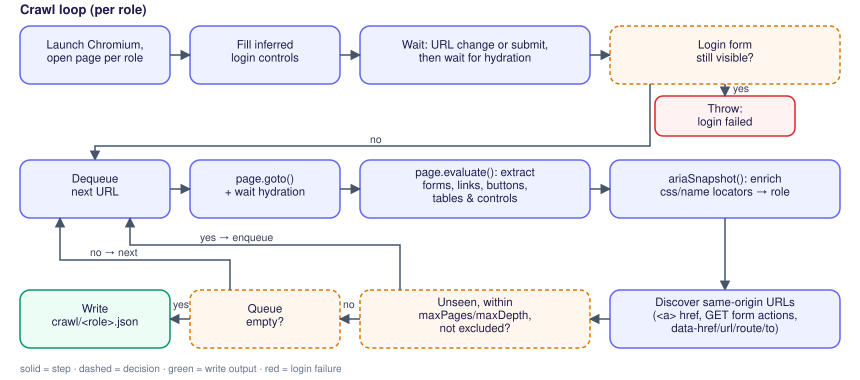
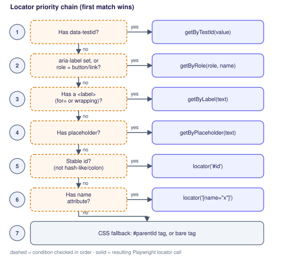
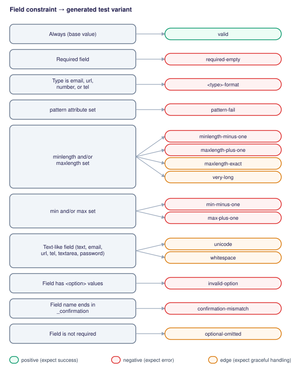

# TathyaTest (tt)

TathyaTest generates Playwright specs from a Playwright crawl of any web app that has a login
form — server-rendered (Laravel, Rails, Django, Spring, …) or a single-page app. It crawls once per
RBAC role, extracts a normalized element model into `crawl/<role>.json`, maps that model against a
dataset and access matrix, and emits Playwright tests for positive, negative, and edge coverage.
Nothing in the generator assumes a framework: CRUD classification, locators, pagination, and
validation variants are keyword rules over the rendered DOM (listed below), and the only app
endpoint a generated test ever calls is the optional `hooks.reset`. The Laravel Blade/Inertia apps
under `case-study/` and SauceDemo are evaluation subjects, not the target.

## Naming

The product is **TathyaTest**; its command-line tool is `tt`; configuration files and environment
variables use the prefix `tathya` (`tathya.config.yaml`, `TATHYA_CONFIG`). The case studies are called
`blade` and `inertia` in stack names and baseline folders; their config file is `tathya.inertia-react.config.yaml`.

## Layout

- `generator/`: TypeScript CLI, Playwright crawler, and test generator, exposed as `tt`
  (`src/{cli,crawl,auth,generate,emit,eval,util}`, tests mirror `src/`).
- `case-study/todo-blade/`, `case-study/todo-inertia-react/`: Laravel Breeze targets with the evaluation harness.
- `tathya.blade.config.yaml`, `tathya.inertia-react.config.yaml`, `tathya.saucedemo.config.yaml`: ready-to-use
  configs for the three evaluation subjects (public seeded credentials only).
- `tathya.config.example.yaml`: canonical, documented config; `make configs` copies it to the local,
  gitignored `tathya.config.yaml` (which also carries `evaluation.stacks` for `tt eval --all-stacks`).
- `tests/manual/`: hand-written baselines; `tests/baseline-public/saucedemo/`: three public Playwright suites
  (git submodules) used as the human-written baseline. See `SOURCES.md` inside for attribution.
- `docs/prd/`: requirements for upcoming work; `docs/history/`: archived plans. See also `CONTRIBUTING.md`.

### Where outputs go

All of these are generated, ignored by git, and never hand-edited. `make clean-outputs` removes them.

| Path | Written by | Contents |
|------|-----------|----------|
| `crawl/<role>.json` | `tt crawl` | per-role crawl contract |
| `tests/generated/` | `tt generate` | specs, `support/tathya.ts`, `manifest.json` |
| `storageState/<role>.json` | Playwright global setup | logged-in session per role |
| `test-results/`, `playwright-report/` | `tt run` | traces and HTML report |
| `metrics/`, `metrics-saucedemo/` | `tt eval` | `report.json` and `report.md` |

## Setup

Prerequisites: Node 24 (`.nvmrc`, `.tool-versions`), Nix for PHP and Composer (`nix-shell`), Git.
The root `shell.nix` provides PHP, Composer and the browser libraries Playwright needs; Node comes from
your version manager (asdf, nvm, or Nix). With direnv, `.envrc` loads it automatically.

```bash
make setup                           # build + link tt, root deps, Playwright browsers, local tathya.config.yaml
make case-study-setup STACK=blade    # composer, .env, key, sqlite, migrate + seed, npm build (STACK=inertia for React)
make serve STACK=blade               # http://127.0.0.1:8000 with COVERAGE=1 (inertia: :8001)
```

Seeded credentials are `admin@example.com` / `password` and `user@example.com` / `password`; the admin
can reach `/admin/users`, the user receives a 403. Run `make verify` to typecheck, lint, test, and smoke `tt`;
`make baseline-init` fetches the public SauceDemo baseline submodules. Manual equivalents of each target are
in the `Makefile`.

## SauceDemo evaluation subject

`tathya.saucedemo.config.yaml` targets `https://www.saucedemo.com` as a third evaluation subject —
a React SPA on a different tech stack to support a generalizability claim. The credentials
(`standard_user` / `secret_sauce`) are public. Because this is an external app with no control
plane, **SUT code coverage and fault injection do not apply**; `tt eval`
reports only model coverage (A), test-suite quality (D), and reliability/efficiency/baseline (E).

The human-written baseline comes from three independent public Playwright suites
(MIT-licensed, three different authors) stored as git submodules:

```bash
make baseline-init   # git submodule update --init --recursive
```

See `tests/baseline-public/saucedemo/SOURCES.md` for provenance, license, and pinned SHAs.

The baseline can be run standalone:

```bash
npx playwright test --config=tests/baseline-public/saucedemo/playwright.config.ts
```

## Commands

```bash
tt init                 # wizard → <project>/tathya.config.yaml
tt crawl                # crawl once per role → crawl/<role>.json
tt generate [--fresh]   # specs → tests/generated/ (re-crawls when the crawl is missing/stale; --fresh forces it)
tt run [playwright args]  # e.g. tt run --project admin-chromium --grep @auth
tt report               # open the HTML report of the last run
tt all [--fresh]        # crawl → generate → run
tt eval [--stack <name> | --all-stacks]
```

Every command takes the global option `-c <path>` to use a config other than `tathya.config.yaml`; it goes
**before** the sub-command (`tt -c tathya.blade.config.yaml generate`). A bare `tt`
prints this list. The smallest working config is the app URL plus one role — everything else
has a default (login path `/login`, output `tests/generated`, coverage `all`, …):

```yaml
baseUrl: http://127.0.0.1:8000
auth:
  roles:
    - { name: admin, username: admin@example.com, password: password }
```

If the app exposes an endpoint that restores its test data, declare it under `hooks.reset`
(`{ method: POST, path: /__testing/reset }` for the case studies) and every generated test
calls it before logging in; without it, tests run against whatever state the app holds.

`tt crawl` logs in once per configured role with a real Chromium (Playwright), starts from the
authenticated landing page, then follows same-origin URLs discovered from the live DOM. It
fails fast with a clear message when the app at `baseUrl` is not running.

`crawl.include` is optional explicit seeding for paths the crawler should visit in addition to
URLs discovered from the authenticated app DOM. Generic configs leave it empty; target-specific
case-study configs may include known routes such as `/todos` or `/admin`.

`tt generate` refreshes crawl outputs if they are missing or stale, then writes auth, forms,
interactions, and RBAC specs into `output.dir` using `output.language` (`ts` or `js`), plus a
`manifest.json` describing every generated test. Valid create/update fields are filled at runtime
from `@faker-js/faker` (seedable via `data.faker.seed`); the target field of a negative/edge case
stays a deterministic literal.

`tt eval` runs the metric-based evaluation and writes `metrics/report.{json,md}`: model coverage,
system-under-test code coverage, fault-detection effectiveness (share of a seeded fault
catalogue the suite detects), test-suite quality, and reliability/efficiency with a hand-written baseline
comparison (`tests/manual/<stack>`). By default it evaluates the config it was pointed at as a
single stack; `--stack <name>` picks one entry of `evaluation.stacks`, and `--all-stacks` runs
the cross-stack study over the Blade and React/Inertia case studies (hours; unreachable stacks
are skipped). SUT coverage and fault injection switch on automatically when the app answers
`GET /__testing/coverage` / `POST /__testing/fault/clear` (the case studies do, with
`COVERAGE=1` and PCOV from `shell.nix`); plain apps simply get the other metric families.
Flags: `--stack`, `--all-stacks`, `--repeat`, `--no-faults`, `--no-coverage`, `--no-baseline`.

### Evaluation vocabulary

`tt eval` reports five metric groups. Older documents and code comments name them "families" (A to E) or
evaluation questions (EQ1 to EQ5); the report headings call them RQ1 to RQ5. They are the same list:

| Group | Report section | Measures |
|-------|----------------|----------|
| A | RQ1 model coverage | elements, routes, forms, fields, navigation, RBAC matrix, constraint kinds, tiers, CRUD per resource |
| B | RQ2 SUT code coverage | PCOV line, branch-proxy, function, and route coverage of the app under test |
| C | RQ3 fault detection | share of seeded faults the suite detects, per class, and localization accuracy |
| D | RQ4 test-suite quality | assertion density, locator mix, brittle-locator ratio, smells |
| E | RQ5 reliability, efficiency, baseline | flake rate, cross-browser kappa, time, throughput, comparison with the manual baseline |

The "fault-detection rate" is what older text calls the mutation score; the JSON report keeps the field
names `mutationScore` and `killed` for compatibility with existing analysis scripts. The research article
uses its own, smaller numbering and does not use this list.

`tt init` asks for a project name, creates a slugged directory, and writes the config inside it:

```bash
tt init
cd my-test
tt crawl
tt generate
tt run
```

The wizard asks for URL/domain, then each credential role with its username and password before
prompting for another role, then asks for the generated Playwright language. Login
controls are inferred at crawl/test runtime. The generated specs are written to `tests/generated`
inside the project directory.

## Developing in VS Code

The repository ships a `.vscode/` folder with recommended extensions, tasks, and debug
configurations, so running the apps, the generator, and the tests, and stepping through any of
them, needs no manual setup beyond the prerequisites.

### Prerequisites

1. Nix, plus [direnv](https://direnv.net) and the **direnv** extension (`mkhl.direnv`) so VS Code
   loads the root `shell.nix` (PHP, Composer, browser libraries) from `.envrc`. Without direnv, start
   VS Code from a shell that already ran `nix-shell`.
2. `make install` (builds `generator/dist/` and links `tt`), `npx playwright install` once, and
   `make case-study-setup STACK=blade|inertia` (see Setup above). PHP only runs inside `nix-shell`;
   the tasks below already wrap it.
3. Open the folder in VS Code and accept the recommended extensions: direnv, Playwright Test,
   Vitest, PHP Debug (Xdebug), Intelephense, YAML.

### Run the applications and `tt`

Use **Terminal > Run Task** (or `Ctrl+Shift+P`, "Tasks: Run Task"):

| Task | What it does |
|------|--------------|
| `app: blade serve` | Blade case study on http://127.0.0.1:8000 with `COVERAGE=1` (PCOV) |
| `app: inertia serve` | React/Inertia case study on http://127.0.0.1:8001 (run `npm run build` in that app first) |
| `app: blade reset db`, `app: inertia reset db` | `php artisan migrate:fresh --seed` (admin and user accounts, password `password`) |
| `generator: build`, `generator: watch` | `tsc` once, or in watch mode while you edit `generator/src` |
| `generator: typecheck`, `generator: test` | `tsc --noEmit`, Vitest |
| `tt: crawl`, `tt: generate`, `tt: run`, `tt: all`, `tt: eval` | The pipeline stages; each asks which config to use (`tathya.blade.config.yaml`, `tathya.inertia-react.config.yaml`, `tathya.saucedemo.config.yaml`, `tathya.config.yaml`) |

Outputs land in `crawl/`, `tests/generated/`, and `metrics/`. They are generated, ignored by git, and
excluded from VS Code search and file watching; never edit them by hand. Start only one app server at
a time on a small machine, and run `tt eval` one stack at a time (`tt eval --stack blade`).

### Debug the generator (TypeScript)

`generator/tsconfig.json` emits source maps, so breakpoints in `generator/src/*.ts` bind to the
compiled `dist/` code.

1. Run `generator: build` once (the launch configurations also do it for you).
2. Set a breakpoint, for example in `generator/src/generate/mapper.ts` or `generator/src/crawl/crud.ts`.
3. Press `F5` and choose **tt: debug command**; pick the config and the command (`crawl`, `generate`,
   `run`, `all`, `eval`, `report`). Use **tt: eval one stack (blade)** for a quick evaluation pass.
4. To debug the crawler (`generator/src/crawl/rendered.ts`), launch `crawl` and set breakpoints
   inside the Node side; the code inside `page.evaluate()` runs in the browser, so debug it with
   `PWDEBUG=1 tt crawl` or `console.log` instead.

The `-c <config>` option belongs before the sub-command: `tt -c tathya.blade.config.yaml generate`.

### Debug the unit tests (Vitest)

Open a test file under `generator/test/` and run **Vitest: current file** (`F5`) to hit breakpoints,
or use the Vitest sidebar (Testing view) to run and debug single tests. `generator: test` runs the
whole suite from the terminal.

### Debug the generated Playwright specs

- Use the Playwright Test extension (Testing view). It reads the root `playwright.config.ts`, which
  takes its target from `TATHYA_CONFIG` (set to `tathya.blade.config.yaml` in `.vscode/settings.json`;
  change it for another app). Tick "Show browser" to watch a test.
- Or press `F5` on **Playwright: generated suite** (headed, `admin-chromium`, one worker) or
  **Playwright: inspector (PWDEBUG)** to step with the Playwright Inspector. Edit the `--project`
  argument for another role or browser (`user-firefox`, `admin-webkit`, ...).
- After a failing run, `npx playwright show-trace test-results/<test>/trace.zip` opens the trace.
- Generated specs are overwritten on every `tt generate`; to change them, change the emitters in
  `generator/src/emit/`, not the specs.

### Debug the Laravel case studies (Xdebug)

The default shells ship PCOV for coverage and no Xdebug, so the evaluation numbers stay comparable.
For stepping through PHP use the separate debug shell:

1. Run the task `app: blade serve (xdebug)` (it uses `case-study/todo-blade/shell.debug.nix`; the
   Inertia app has an equivalent `shell.debug.nix`).
2. Start **Laravel: listen for Xdebug (9003)** and set breakpoints in `app/Http/Controllers/` or
   `app/Http/Requests/`.
3. Load a page or run a generated test; execution stops on your breakpoint.
4. Stop the Xdebug server and return to `app: blade serve` before running `tt eval`, since coverage and
   timing are only comparable on the standard shell.

### Troubleshooting

| Symptom | Fix |
|---------|-----|
| Breakpoints show as unbound | run `generator: build`; check `dist/*.js.map` exists; launch with a configuration that has `sourceMaps` (all provided ones do) |
| `tt`, `node`, or `php` not found in the VS Code terminal | direnv is not loaded: run "direnv: Reload environment", or start VS Code from `nix-shell` |
| `Error: ... connect ECONNREFUSED 127.0.0.1:8000` | the application is not running; start `app: blade serve` first |
| Port 8000 or 8001 already in use | stop the other server task (one app at a time on small hosts) |
| WebKit project fails to launch | it needs a display; the root `playwright.config.ts` starts Xvfb when `DISPLAY` is unset, so install Xvfb or skip WebKit |
| `unknown option '-c'` | put `-c <config>` before the sub-command |

## How DOM extraction works

`tt crawl` extracts the DOM with a real Chromium browser (Playwright), not an HTML parser.
It launches `chromium.launch()`, opens one `page` per configured role with `baseURL` set,
logs in once, then follows same-origin links/forms discovered live from the rendered page.



**Login.** Login controls are inferred by scoring candidate inputs in the rendered HTML
(`generator/src/auth/login.ts`): username (`type="email"` +100, `autocomplete="username"` +90,
`autocomplete="email"` +80, name/id/label matching `email|username|user|account|identifier|handle`
+50), password (`type="password"` +100, matching `password|passcode|pin` +50), submit
(`data-test`/`data-testid` present +100, is a `<button>` +20, text matching
`log in|login|sign in|sign-in` +50, `type="submit"` +10). The submit click is raced against
`page.waitForURL` (5s timeout) for a path change, then the crawler waits for
`domcontentloaded` and `networkidle` so client-rendered apps finish hydrating. If the
landing path is still the login path or `/`, it checks whether a password-like control
is still visible (`input[type="password"]`, `[autocomplete="current-password"]`,
`[name*="password"]`, `[id*="password"]`, `[placeholder*="Password"]`) and fails loudly
if so, rather than silently crawling a login page.

**Per-page extraction.** Everything below runs inside one `page.evaluate()` call per
visited page, reading the live DOM:

- **Forms** (`form`): resolved `action` (path + query), normalized `method`
  (`GET`/`POST`), `noValidate`, and a CRUD classification (see below). Fields come from
  `input, select, textarea`, excluding unnamed, hidden, submit, and button inputs; each
  field captures its `type`, `label`, `required` flag, constraint attributes
  (`minlength`, `maxlength`, `min`, `max`, `step`, `pattern`, `inputmode`, `accept`), and
  `<option>` values for selects. The submit control is
  `button[type="submit"], input[type="submit"]`, falling back to a typeless `<button>`.
- **Links** (`a[href]`), kept only when same-origin.
- **Buttons**, collected from three selector passes so no interactive control is missed:
  `button`; `input[type=button|submit|reset|image]`; and
  `[role=button|menuitem|tab]` elements that aren't already `<a>`/`<button>`/`<input>`.
- **Tables** (`table`): header text and `tbody tr` row count.
- **Orphan `<select>` controls** outside any `<form>` — these capture SPA sort/filter
  dropdowns that aren't part of a submittable form.
- Visibility for every element is computed with `checkVisibility()` (falling back to a
  bounding-rect + `visibility` check), so hidden duplicates (e.g. responsive nav clones)
  can be deduplicated later in `mapper.ts`.

**Accessibility enrichment.** After the raw extraction, the crawler takes a
`page.ariaSnapshot()` of the whole page and of each `<form>`, parses it, and upgrades any
element that only got a weak `css` or `name` locator up to a `role` locator — but it never
overrides a `testid`, `label`, or `placeholder` locator, since those already satisfy the
priority chain below.

**Discovering more URLs.** Same-origin URLs are harvested from `a[href]`; `form[action]`
only when the form's method is `GET` (a `page.goto` to a POST-only action would 405);
`formaction` on buttons/inputs, same GET-only rule; and an exact list of custom
attributes: `data-href`, `data-url`, `data-route`, `data-to`. New URLs are queued subject
to `crawl.maxPages`, `crawl.maxDepth` (counted by path segments), and `crawl.exclude`
prefix matches; `crawl.include` seeds extra paths the crawler should always visit. A
response that isn't ok and renders zero forms/links/controls is treated as an error page
and dropped rather than explored further.

## Keyword rules for test generation

Every classification below is an exact string/regex match in the generator source — not
a heuristic guess. Keywords are grouped by the file that owns them.

### 1. Locator priority chain

`generator/src/crawl/rendered.ts` picks a locator per element at crawl time, in this
exact order (never positional/`nth-child`); `generator/src/generate/locator.ts` turns the chosen
strategy into a Playwright call when emitting a spec:



A "stable" id rejects anything matching `/[0-9a-f]{8,}|:/` (hashed or framework-generated
ids such as React's `:r3:`). Accessible roles are inferred from the tag/type:
`button`→button, `textarea`→textbox, `select`→combobox, `a[href]`→link, and `<input>` by
`type`: `button|submit|reset|image`→button, `checkbox`→checkbox, `radio`→radio,
`number`→spinbutton, everything else→textbox. The aria-snapshot enrichment pass later
normalizes `searchbox` to `textbox` and only accepts
`textbox|button|link|checkbox|radio|combobox|spinbutton` as valid roles.

### 2. HTML constraint → test-variant rules

`generator/src/generate/fieldgen.ts` turns captured field constraints into named variants. Each
row is one generated test case:

| Trigger | Variant name | Tier | Value | Expected outcome |
|---|---|---|---|---|
| always | `valid` | positive | a realistic value for the field's type | success |
| `required` (or `data.requiredFields`) | `required-empty` | negative | empty string | error |
| `type` is `email`, `url`, or `tel` | `<type>-format` | negative | a value of the wrong shape for that type | error |
| `pattern` attribute present | `pattern-fail` | negative | the first of a fixed candidate list that fails the anchored pattern (skipped when the pattern is invalid or nothing fails it) | error |
| `minlength` set | `minlength-minus-one` | negative | one character short of the minimum | error |
| `maxlength` set | `maxlength-plus-one` | negative | one character past the maximum | error |
| `maxlength` set | `maxlength-exact` | edge | a format-valid value of exactly that length | success |
| `maxlength` set (or not, for text-like fields) | `very-long` | edge | ~10× the limit, or 10,000 chars with no limit | graceful (no 500) |
| `min` set | `min-minus-one` | negative | one unit below the minimum in the field's own format: −1, −1 day (`date`), −1 minute (`time`, `datetime-local`), −1 month, −1 week; skipped when the boundary cannot be parsed | error |
| `max` set | `max-plus-one` | negative | one unit above the maximum, same rules | error |
| `step` set on `number`/`range` | `step-misaligned` | negative | `min` (or 0) + half a step | error |
| `type=file` with `accept` | `accept-mismatch` | negative | a fixture upload of a MIME type the `accept` list rejects | error |
| text-like field | `unicode` | edge | mixed-script/emoji string | graceful |
| text-like field | `whitespace` | edge | the valid value padded with leading/trailing spaces | graceful |
| field has `<option>`s (select/radio) | `invalid-option` | negative | an option value that doesn't exist | error |
| field name listed in `data.unique`/`data.duplicates` | `duplicate` | negative | a value already taken | error |
| field name ends in `_confirmation` | `confirmation-mismatch` | negative | the valid value plus a suffix, so it disagrees with its source field | error |
| field is not `required` | `optional-omitted` | edge | field omitted entirely | graceful |

Supporting keyword lists:

- **Text-like types** (get `unicode`/`whitespace`/unlimited `very-long` variants):
  `text`, `search`, `email`, `url`, `tel`, `textarea`, `password`.
- **Confirmation detection**: a field name ending in `_confirmation` (set by the crawler
  when it sees that suffix) or listed in `data.confirmFields`; such fields skip all
  length/format variants and instead pair with their source field.
- **Natively unfalsifiable variants**: on a form without `novalidate`, the browser's own
  constraint validation blocks submission before JS runs, so `maxlength-plus-one`,
  `invalid-option`, `confirmation-mismatch`, and `accept-mismatch` (`accept` is a picker
  hint, not a validated constraint) are skipped — they'd never reach the server-side oracle.
- **No format negative for `number`, `date`/`time`/`month`/`week`, or `color` inputs**: the
  browser sanitises a malformed value to empty before the app ever sees it (and Playwright
  refuses to type it), so the case is covered by `required-empty`, `min`/`max`, and `step`
  instead.
- **File inputs** are never `fill()`ed: the valid value is a MIME type the `accept` list
  allows (`image/*` → `image/png`, `.pdf` → `application/pdf`, none → `text/plain`) and the
  emitted test uploads a tiny in-memory fixture of it via `setInputFiles`.



### 3. CRUD-operation classification

The crawler records a form's raw signals and `generator/src/crawl/crud.ts` classifies them in
Node (pure, unit-tested), framework-neutrally, in this precedence:

```
0. logout               action path segment logout|log-out|signout|sign-out, or submit text
                        "Log out"/"Sign out"  -> logout (an auth scenario: "<role> logs out")
1. explicit verb        hidden _method (Laravel/Rails/Symfony/Spring), data-turbo-method (Rails
                        Turbo), hx-put|hx-patch|hx-delete (HTMX):  PUT|PATCH -> update, DELETE -> delete
2. form method = GET    -> unknown (search / filter form; never mutates)
3. action-path segment  delete|destroy|remove -> delete;  update|edit -> update;
                        create|store|new|add -> create
4. submit-button text   delete|remove|destroy -> delete;  update|save changes|edit -> update;
                        create|add|save|submit -> create
5. any other POST       -> create
```

This feeds the mapper: update forms never get a `duplicate` negative variant (editing a
record to its own existing value isn't a real uniqueness violation), and a fieldless
delete form (e.g. a lone `_method=DELETE` button) gets a dedicated `delete` positive case
instead of the generic `valid` label.

### 4. Pagination keywords

`generator/src/generate/mapper.ts` classifies links/buttons as pagination controls by exact label
match (after decoding HTML entities such as `&raquo;` — Laravel's stock paginator escapes
them into its `aria-label` — then lowercasing and stripping arrow decoration `«»‹›←→<>` when
the label also contains alphanumerics) or by query-parameter key:

| Action | Label regex |
|---|---|
| previous | `^(previous\|prev\|older\|‹\|«\|<\|←)$` |
| next | `^(next\|newer\|›\|»\|>\|→)$` |
| first | `^(first\|<<)$` |
| last | `^(last\|>>)$` |
| page | `^page\s+\d+$` or a bare `^\d+$` |

A link also counts as a pagination control if its query string contains any key matching
`^(page|p|pageNo|pageNum|pageNumber|offset|start|cursor|after|before|limit)$`. A
`page`/`p`/`pageNo`/`pageNum`/`pageNumber` key whose value is `1` is treated as the
default page and stripped before comparison, so a link pointing at `?page=1` collapses
with the unparameterized URL instead of generating a redundant case. Only one
representative control per action per page is kept, preferring a visible one over a
hidden responsive duplicate.

### 5. Field-name semantic keywords (for realistic fill values)

`generator/src/generate/faker.ts` matches the field's `name` attribute against a prioritized list
of patterns to pick a meaningful `@faker-js/faker` expression — name-based intent wins
over the raw `type` attribute. Patterns, in priority order: `email`; `username`/`user`/
`login`; `url`/`website`/`homepage`/`link`; `slug`; `phone`/`tel`/`mobile`; `_at` suffix/
`date`/`deadline`/`birthday`; `price`/`amount`/`cost`/`total`/`salary`; `qty`/`quantity`/
`count`/`stock`/`age`/`year`; `firstname`/`first_name`/`fname`; `lastname`/`last_name`/
`lname`; `description`/`body`/`content`/`notes`/`message`/`comment`/`bio`/`summary`;
`title`/`subject`/`headline`/`label`; `name`/`_name` suffix/`fullname`; `company`/
`organization`/`organisation`; `city`; `country`; `zip`/`postcode`/`postal`; `address`/
`street`; `color`/`colour`. If no name pattern matches, the field's HTML `type` picks a
generic faker expression instead (`email`, `url`, `tel`, `number`, `range`, `date`,
`datetime-local`, `time`, `month`, `password`, `color`).

### 6. Other classification rules worth knowing

- A link or button is treated as a plain **interaction** test only if it isn't already
  classified as pagination and isn't a form's own submit control.
- **REST show routes are inferred** (`crawl.inferRestRoutes`, default on): a crawled
  `/todos/7/edit` page or a `DELETE /todos/7` form implies a `/todos/7` page nobody linked
  to; it gets an allowed-route case titled `… (inferred from /todos/7/edit)`. An app that has
  no such page answers 404/405 with no app content behind it — the test then skips itself, so a
  wrong inference never fails a run — while a declared-but-broken route (5xx) fails like any
  other. Set `inferRestRoutes: false` to skip the inference entirely.
- **RBAC affordances**: on a page shape that several roles reach, a link one role gets and
  another doesn't (the admin-only "Users" navbar link) becomes a negative for the latter —
  `user does not see the "Users" link to /admin/users on /dashboard` asserts the locator has
  zero matches. Links only (button labels legitimately differ per role, e.g. the account menu
  shows the user's name); pagination and logout links are ignored.
- Interaction links are deduplicated by route shape plus **sorted query keys** (values
  dropped) — so `/todos?status=done` and `/todos?status=pending` stay distinct test
  targets, but `/todos?status=done&sort=asc` and `/todos?sort=asc&status=done` collapse
  into one.
- The login negative-password test always uses the literal value
  `<configured-password>-wrong`.
- A confirmation field's value is emitted as a reference to its source field (so the spec
  echoes whatever the source field generated at runtime), not a literal.

## Coverage

`coverage` can be `positive`, `negative`, `edge`, or `all`.

- Positive: valid login, valid form submissions, authorized navigation.
- Negative: wrong password, required-empty, type/pattern/length/range failures, invalid options,
  duplicate configured unique fields, confirmation mismatch, RBAC blocked routes. Use
  `data.requiredFields` to force blank negatives for fields the crawl missed.
- Edge: exact boundaries, long values, unicode, whitespace, optional omissions.

Assertions check state instead of exact error messages. Server-side validation expects a visible
error indicator from `oracle.errorSelector`; native validation checks HTML validity state.

See [Keyword rules for test generation](#keyword-rules-for-test-generation) above for the
exact trigger that produces each negative/edge variant.

## Read-only monitoring

Every generated test is tagged `@read` or `@write`. A test is *mutating* (`@write`) when running
it can change app data: any POST/PUT/PATCH/DELETE form and all of its validation variants, a
generic button click, and the wrong-password login. Everything a GET can do is `@read`: logging
in, opening every crawled route, following links, paging, and submitting GET search/filter
forms with their robustness variants.

Two ways to use that:

```bash
tt run --read-only            # run the existing suite, skipping every @write test
tt all --read-only            # crawl + generate ONLY the @read checks, then run them
```

`--read-only` on `generate`/`all` (or `mode: read-only` in the config) produces a status sweep
over the whole crawled surface that is safe to point at staging or production: tests reuse the
project's stored session instead of logging in each time, never call the reset hook, and assert
that every page they open is up (healthy response, or an SPA route that still renders) before
exercising it. Run it on a schedule — a cron line or CI job such as

```bash
*/15 * * * * cd /srv/tathya && tt -c tathya.prod.config.yaml all --read-only
```

turns the suite into UptimeRobot-style feature monitoring: not "does the home page answer" but
"does every route, link, pager and search still work for every role". `tt eval` notes read-only
runs in the report, since form/field/CRUD coverage then only describes GET forms.

## Roadmap: other test frameworks

The generator targets Playwright today. Supporting Cypress (and other frameworks) through an adapter
layer is specified in [`docs/prd/`](docs/prd/README.md): architecture, scenario-plan and emitter
interface, runner and evaluation integration, the Cypress adapter, config and CLI changes, test
strategy, and a milestone roadmap.

## Known Gaps

Custom Laravel validation rules, closure rules, FormRequest logic that is not visible in HTML,
security/injection testing, performance testing, and mobile/native apps are out of scope for this
prototype. Use `data.unique` and `data.confirmFields` for server-only hints the crawler cannot infer.
