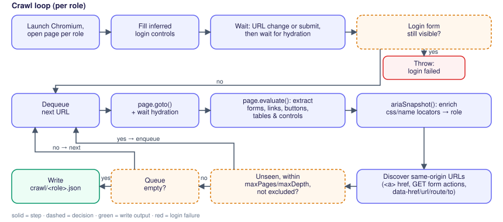
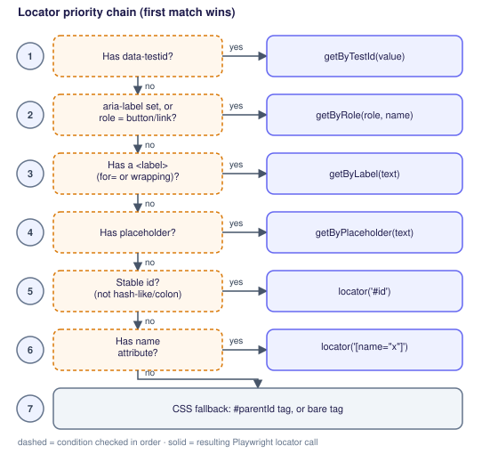
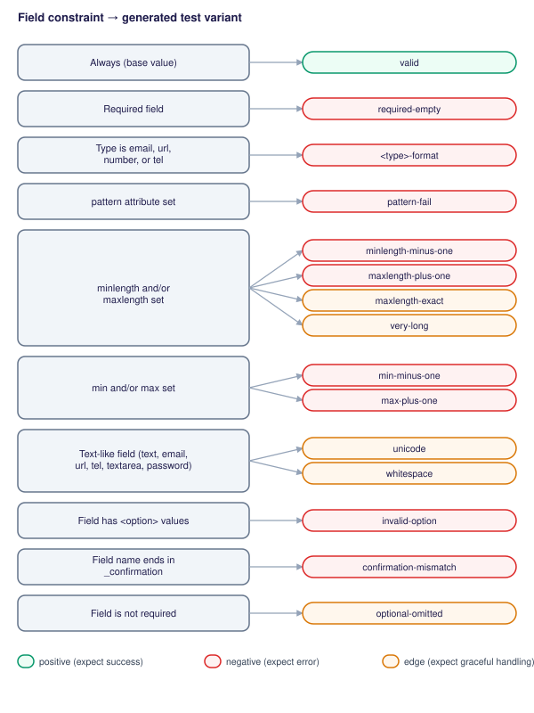

# How TathyaTest works

This page explains what `tt` does and which rules it applies, so you can predict the tests it generates and
know where to change a rule. In short: `tt crawl` reads the rendered DOM of your app once per role; `tt generate`
turns that model into tests using the keyword rules below; assertions check state (an error indicator, a URL,
a validity flag), never exact message text.

## How DOM extraction works

`tt crawl` extracts the DOM with a real Chromium browser (Playwright), not an HTML parser.
It launches `chromium.launch()`, opens one `page` per configured role with `baseURL` set,
logs in once, then follows same-origin links/forms discovered live from the rendered page.



**Login.** One function, `generator/src/auth/login-dom.ts` (copied into both support modules), reads
the rendered login page and picks the controls among the *visible* ones: password
(`type="password"` +100, name/id/label matching `password|passcode|pin` +50), username (`type="email"`
+100, `autocomplete="username"` +90, `autocomplete="email"` +80, matching
`email|username|user|account|identifier|handle` +50, else the first other text field — never a hidden
input), submit (`data-test`/`data-testid` present +100, is a `<button>` +20, text matching
`log in|login|sign in|sign-in` +50, submits the form +10; a `<button>` without a `type` submits). The
click is raced against a path change (5s), then the crawler waits for the password field to disappear
and for the network to settle (bounded at 5s). If the landing path is still the login path or `/` and
a password field is visible, the crawl fails loudly rather than crawling a login page.

**Per-page extraction.** Everything below runs inside one `page.evaluate()` call per
visited page, reading the live DOM:

- **Forms** (`form`): resolved `action` (path + query) and whether the attribute exists; `method` — the
  verb a submission really sends (`POST` also when `data-method`, `data-turbo-method` or an `hx-*`
  attribute replaces the native `GET`); `noValidate`; and a CRUD classification (see below). Fields come
  from `input, select, textarea`, excluding unnamed, hidden, button, **disabled and read-only** controls;
  each field captures its `type`, `label`, `required` flag, constraint attributes (`minlength`,
  `maxlength`, `min`, `max`, `step`, `pattern`, `inputmode`, `accept`), `<option>` values for selects, and
  whether it already holds a value. A **radio group** is one field whose options are its radios. The
  submit control is `button[type="submit"], input[type="submit"]`, falling back to a typeless `<button>`.
- **Links** (`a[href]`), kept only when same-origin. A fragment or `javascript:` link is marked
  `inPage` (clicking it runs script instead of navigating), and a link that script turns into a write
  carries its `method`.
- **Buttons**, collected from three selector passes so no interactive control is missed:
  `button`; `input[type=button|submit|reset|image]`; and
  `[role=button|menuitem|tab]` elements that aren't already `<a>`/`<button>`/`<input>`.
- **Tables** (`table`): header text and `tbody tr` row count.
- **Orphan `<select>` controls** outside any `<form>` — these capture SPA sort/filter
  dropdowns that aren't part of a submittable form.
- Visibility for every element is computed with `checkVisibility()` (falling back to a
  bounding-rect + `visibility` check), so hidden duplicates (e.g. responsive nav clones)
  can be deduplicated later in `mapper.ts`.

**Accessibility check.** After the raw extraction, the crawler verifies locators against Playwright's
accessibility tree, element by element: a `role` name read from the DOM is replaced when it is not the
element's accessible name, and an element with only a weak `css` or `name` locator is upgraded to
`role:name` when it has one. `testid`, `label`, `placeholder` and stable `id` locators are left alone. A
button or link that is left with a CSS selector matching several elements is dropped: no test could
address it.

**Discovering more URLs.** Same-origin URLs are harvested from `a[href]`; `form[action]`
only when the form's method is `GET` (a `page.goto` to a POST-only action would 405);
`formaction` on buttons/inputs, same GET-only rule; and an exact list of custom
attributes: `data-href`, `data-url`, `data-route`, `data-to`. New URLs are queued subject
to `crawl.maxPages`, `crawl.maxDepth` (path segments; deeper links are skipped), and `crawl.exclude`
prefix matches; logout paths are never followed. `crawl.include` seeds extra paths the crawler should
always visit.

**Which pages are recorded.** Only pages the role can use: a 401, 403 or 5xx response is never
recorded, however much layout it renders; a 404 is kept only when it stayed on the requested path and
renders links, forms or controls (single-page apps serve deep links that way). A redirect target is
recorded once. A page that shows the login form triggers one re-login and a retry; the login page itself
is never recorded. A page that cannot be loaded or read (a download, a timeout) is skipped with a
warning. Role files are written only when every role succeeded.

**Cached crawls.** `tt generate` reuses `crawl/<role>.json` only while it matches the config: same
contract version, same `baseUrl`, and the same hash of the login path, role usernames and `crawl`
settings. `--fresh` always crawls again.

## From rules to specs: the IR

Generation happens in two rule layers and one rendering step, so every rule applies to every output framework:

1. **Generation rules** (`generator/src/generate/`) decide *which* tests exist: the keyword rules below turn
   the crawl into `TestCase`s.
2. **Scenario rules** (`generator/src/ir/build.ts`) decide *how* each test runs: login mode, page visits, how
   each field is filled, which oracle judges the outcome, when a test skips itself, step titles and tags. The
   result is a `TestPlan`, plain data in `ir/types.ts`.
3. **Adapters** (`generator/src/adapters/playwright`, `adapters/cypress`) render the plans in their framework's
   syntax and run them. `--framework playwright|cypress` (or `output.framework`) picks one.

To add a rule, see [adapters/adding-rules.md](adapters/adding-rules.md); for where each existing rule lives and how
each framework writes it, see [adapters/ir-migration-report.md](adapters/ir-migration-report.md).

## Keyword rules for test generation

Every classification below is an exact string/regex match in the generator source — not
a heuristic guess. Keywords are grouped by the file that owns them.

### 1. Locator priority chain

`generator/src/crawl/dom-extract.ts` picks a locator per element at crawl time, in this
exact order (never positional/`nth-child`); each adapter turns the chosen strategy into its framework's call
when emitting a spec (`adapters/playwright/locator.ts`: `getByRole` …; `adapters/cypress`: `cy.tt(byRole(…))`,
resolved with `@testing-library/dom` the way Playwright matches names):



A "stable" id rejects anything matching `/[0-9a-f]{8,}|:/` (hashed or framework-generated
ids such as React's `:r3:`). Accessible roles are inferred from the tag/type:
`button`→button, `textarea`→textbox, `select`→combobox, `a[href]`→link, and `<input>` by
`type`: `button|submit|reset|image`→button, `checkbox`→checkbox, `radio`→radio,
`number`→spinbutton, everything else→textbox; an explicit `role` attribute wins over all of these.
A label is used only when its whole text is its own
wording: a label wrapping a select or textarea contains that control's text too, so such a field is
located by its accessible role instead.

### 2. HTML constraint → test-variant rules

`generator/src/generate/fieldgen.ts` turns captured field constraints into named variants. Each
row is one generated test case:

| Trigger | Variant name | Tier | Value | Expected outcome |
|---|---|---|---|---|
| always | `valid` | positive | a realistic value for the field's type | success |
| `required` (or `data.requiredFields`) | `required-empty` | negative | empty string | error |
| `type` is `email`, `url`, or `tel` | `<type>-format` | negative | a value of the wrong shape for that type | error |
| `pattern` attribute present | `pattern-fail` | negative | the first of a fixed list of non-empty candidates that fails the anchored pattern (skipped when the pattern is invalid or nothing fails it) | error |
| `minlength` ≥ 2 | `minlength-minus-one` | negative | one character short of the minimum (an empty value never counts as too short) | error |
| `maxlength` set | `maxlength-plus-one` | negative | one character past the maximum | error |
| `maxlength` set | `maxlength-exact` | edge | a format-valid value of exactly that length | success |
| `maxlength` set (or not, for text-like fields) | `very-long` | edge | ~10× the limit, or 10,000 chars with no limit | graceful (no 500) |
| `min` set | `min-minus-one` | negative | one unit below the minimum in the field's own format: −1, −1 day (`date`), −1 minute (`time`, `datetime-local`), −1 month, −1 week; skipped when the boundary cannot be parsed | error |
| `max` set | `max-plus-one` | negative | one unit above the maximum, same rules | error |
| `step` set on `number`/`range` | `step-misaligned` | negative | `min` (or 0) + half a step | error |
| `type=file` with `accept` | `accept-mismatch` | negative | a fixture upload of a MIME type the `accept` list rejects | error |
| text-like field | `unicode` | edge | mixed-script/emoji string | graceful |
| text-like field | `whitespace` | edge | the valid value padded with leading/trailing spaces | graceful |
| field has `<option>`s (select/radio) | `invalid-option` | negative | an option value that doesn't exist | error |
| field name listed in `data.unique`/`data.duplicates` | `duplicate` | negative | a value already taken | error |
| field name ends in `_confirmation` | `confirmation-mismatch` | negative | the valid value plus a suffix, so it disagrees with its source field | error |
| field is not `required` | `optional-omitted` | edge | field omitted entirely | graceful |

Supporting keyword lists:

- **Text-like types** (get `unicode`/`whitespace`/unlimited `very-long` variants):
  `text`, `search`, `email`, `url`, `tel`, `textarea`, `password`.
- **Confirmation detection**: a field name ending in `_confirmation` (set by the crawler
  when it sees that suffix) or listed in `data.confirmFields`; such fields skip all
  length/format variants and instead pair with their source field.
- **Natively unfalsifiable variants**: on a form without `novalidate`, the browser's own
  constraint validation blocks submission before JS runs, so `maxlength-plus-one`,
  `invalid-option`, `confirmation-mismatch`, and `accept-mismatch` (`accept` is a picker
  hint, not a validated constraint) are skipped — they'd never reach the server-side oracle.
  `duplicate`, a `tel-format` on a field without `pattern`, and a `required-empty` forced by
  `data.requiredFields` are judged by the app's error display, because the browser cannot see them.
- **Radio groups** are one field: a value is chosen by checking the radio that carries it.
- **No format negative for `number`, `date`/`time`/`month`/`week`, or `color` inputs**: the
  browser sanitises a malformed value to empty before the app ever sees it (and Playwright
  refuses to type it), so the case is covered by `required-empty`, `min`/`max`, and `step`
  instead.
- **File inputs** are never `fill()`ed: the valid value is a MIME type the `accept` list
  allows (`image/*` → `image/png`, `.pdf` → `application/pdf`, none → `text/plain`) and the
  emitted test uploads a tiny in-memory fixture of it via `setInputFiles`.



### How a test judges the outcome

| Submission | Checks |
|---|---|
| rejected (negative variants) | native: the field's `validity.valid` is false. App-side: an `oracle.errorSelector` match is visible and the URL is the form's page |
| delete | the record's form is gone, and no server error |
| state change (a field-less update such as "Mark done") | the form is still there and reads differently |
| GET search or filter that declares `method` or `action` | the browser is on the action path and the URL carries the submitted values |
| create | the submitted text is shown, and **no validation error** |
| update of a prefilled edit form | no validation error, and reopening the edit page shows the new value |
| other accepted input (exact length, whitespace, omitted optional field) | no server error and no validation error |
| very long or unusual input | no server error (the app may refuse it) |

"No validation error" means no form shows an invalid field (`aria-invalid`, `:user-invalid`) or a
non-empty element matching `oracle.errorSelector`; messages outside forms and styled buttons or links do
not count. "No server error" looks at the response status and at error-page wording, so a page that merely
mentions "500" passes.

### Finding the form and the controls

A form test first finds its form: the one matching the crawled action that holds the submit button (a form
without an `action` is the one without that attribute that holds it). Fields and the submit are looked up
inside it. When a row action's record is not on the page, because list order differs between runs, the same
action on another row stands in; no other form ever does. Role and placeholder names are matched whole.

A crawled form or control that is **missing** fails the test. One that is present but **hidden** (a closed
menu) skips it, and `tt eval` lists tests that no browser ever executed.

### 3. CRUD-operation classification

The crawler records a form's raw signals and `generator/src/crawl/crud.ts` classifies them in
Node (pure, unit-tested), framework-neutrally, in this precedence:

```
0. logout               action path segment logout|log-out|signout|sign-out, or submit text
                        "Log out"/"Sign out"  -> logout (an auth scenario: "<role> logs out")
1. explicit verb        hidden _method (Laravel/Rails/Symfony/Spring), data-turbo-method (Rails
                        Turbo), hx-put|hx-patch|hx-delete (HTMX):  PUT|PATCH -> update, DELETE -> delete
2. form method = GET    -> unknown (search / filter form). A form with neither `method` nor `action`
                        is handled by script: only its submit text (rule 4) classifies it
3. action-path segment  delete|destroy|remove -> delete;  update|edit -> update;
                        create|store|new|add -> create
4. submit-button text   delete|remove|destroy -> delete;  update|save changes|edit -> update;
                        create|add|save|submit -> create
5. any other POST       -> create
```

This feeds the mapper: update forms never get a `duplicate` negative variant (editing a
record to its own existing value isn't a real uniqueness violation), and a fieldless
delete form (e.g. a lone `_method=DELETE` button) gets a dedicated `delete` positive case
instead of the generic `valid` label.

### 4. Pagination keywords

`generator/src/generate/mapper.ts` classifies links/buttons as pagination controls by exact label
match (after decoding HTML entities such as `&raquo;` — Laravel's stock paginator escapes
them into its `aria-label` — then lowercasing and stripping arrow decoration `«»‹›←→<>` when
the label also contains alphanumerics) or by query-parameter key:

| Action | Label regex |
|---|---|
| previous | `^(previous\|prev\|older\|‹\|«\|<\|←)$` |
| next | `^(next\|newer\|›\|»\|>\|→)$` |
| first | `^(first\|<<)$` |
| last | `^(last\|>>)$` |
| page | `^page\s+\d+$` or a bare `^\d+$` |

A link also counts as a pagination control if its query string contains any key matching
`^(page|p|pageNo|pageNum|pageNumber|offset|start|cursor|after|before|limit)$`. A
`page`/`p`/`pageNo`/`pageNum`/`pageNumber` key whose value is `1` is treated as the
default page and stripped before comparison, so a link pointing at `?page=1` collapses
with the unparameterized URL instead of generating a redundant case. Only one
representative control per action per page is kept, preferring a visible one over a
hidden responsive duplicate.

### 5. Field-name semantic keywords (for realistic fill values)

`generator/src/generate/faker.ts` matches the field's `name` attribute against a prioritized list
of patterns to pick a meaningful `@faker-js/faker` expression — name-based intent wins
over the raw `type` attribute. Patterns, in priority order: `email`; `username`/`user`/
`login`; `url`/`website`/`homepage`/`link`; `slug`; `phone`/`tel`/`mobile`; `_at` suffix/
`date`/`deadline`/`birthday`; `price`/`amount`/`cost`/`total`/`salary`; `qty`/`quantity`/
`count`/`stock`/`age`/`year`; `firstname`/`first_name`/`fname`; `lastname`/`last_name`/
`lname`; `description`/`body`/`content`/`notes`/`message`/`comment`/`bio`/`summary`;
`title`/`subject`/`headline`/`label`; `name`/`_name` suffix/`fullname`; `company`/
`organization`/`organisation`; `city`; `country`; `zip`/`postcode`/`postal`; `address`/
`street`; `color`/`colour`. If no name pattern matches, the field's HTML `type` picks a
generic faker expression instead (`email`, `url`, `tel`, `number`, `range`, `date`,
`datetime-local`, `time`, `month`, `password`, `color`).

Short keywords are matched as whole words of the name (`country` is not a `count`, `message` has no
`age`). Valid values respect `minlength`, `maxlength`, `min`, `max`, `step` and one-sided date bounds; a
select skips an empty placeholder option; each browser project draws its own values from `data.faker.seed`.

### 6. Other classification rules worth knowing

- A link or button is treated as a plain **interaction** test only if it isn't already
  classified as pagination and isn't a form's own submit control. A fragment or `javascript:` link is a
  scripted control: one click test per name, with no landing page. A link to a record
  (`/todos/14/edit`) is checked by its route shape.
- **Read-only** keeps only plain navigation: forms that send anything but GET, forms handled by script,
  links with `data-method` or `hx-*` writes, and clicks on buttons and in-page links are dropped.
- **REST show routes are inferred** (`crawl.inferRestRoutes`, default on): a crawled
  `/todos/7/edit` page or a `DELETE /todos/7` form implies a `/todos/7` page nobody linked
  to; it gets an allowed-route case titled `… (inferred from /todos/7/edit)`. An app that has
  no such page answers 405, or 404 with no app content behind it — the test then skips itself, so a
  wrong inference never fails a run — while a declared-but-broken route (5xx) fails like any
  other. Set `inferRestRoutes: false` to skip the inference entirely.
- **RBAC affordances**: on a page shape that several roles reach, a link one role gets and
  another doesn't (the admin-only "Users" navbar link) becomes a negative for the latter —
  `user does not see the "Users" link to /admin/users on /dashboard` asserts the locator has
  zero matches. Links only (button labels legitimately differ per role, e.g. the account menu
  shows the user's name); pagination and logout links are ignored.
- Interaction links are deduplicated by route shape plus **sorted query keys** (values
  dropped) — so `/todos?status=done` and `/todos?status=pending` stay distinct test
  targets, but `/todos?status=done&sort=asc` and `/todos?sort=asc&status=done` collapse
  into one.
- The login negative-password test always uses the literal value
  `<configured-password>-wrong`.
- A confirmation field's value is emitted as a reference to its source field (so the spec
  echoes whatever the source field generated at runtime), not a literal.


## Coverage

`coverage` can be `positive`, `negative`, `edge`, or `all`.

- Positive: valid login, valid form submissions, authorized navigation.
- Negative: wrong password, required-empty, type/pattern/length/range failures, invalid options,
  duplicate configured unique fields, confirmation mismatch, RBAC blocked routes. Use
  `data.requiredFields` to force blank negatives for fields the crawl missed.
- Edge: exact boundaries, long values, unicode, whitespace, optional omissions.

Assertions check state instead of exact error messages. Server-side validation expects a visible
error indicator from `oracle.errorSelector`; native validation checks HTML validity state.

See [Keyword rules for test generation](#keyword-rules-for-test-generation) above for the
exact trigger that produces each negative/edge variant.
