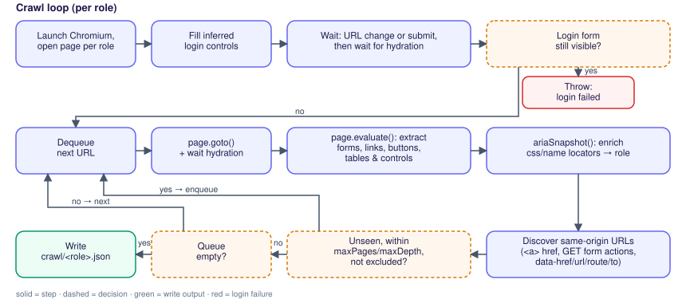
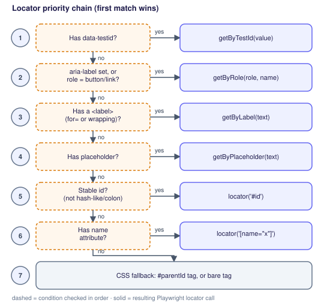
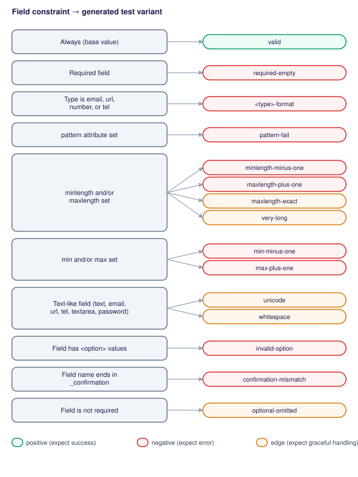

# How TathyaTest works

This page explains what `tt` does and which rules it applies, so you can predict the tests it generates and
know where to change a rule. In short: `tt crawl` reads the rendered DOM of your app once per role; `tt generate`
turns that model into tests using the keyword rules below; assertions check state (an error indicator, a URL,
a validity flag), never exact message text.

## How DOM extraction works

`tt crawl` extracts the DOM with a real Chromium browser (Playwright), not an HTML parser.
It launches `chromium.launch()`, opens one `page` per configured role with `baseURL` set,
logs in once, then follows same-origin links/forms discovered live from the rendered page.



**Login.** Login controls are inferred by scoring candidate inputs in the rendered HTML
(`generator/src/auth/login.ts`): username (`type="email"` +100, `autocomplete="username"` +90,
`autocomplete="email"` +80, name/id/label matching `email|username|user|account|identifier|handle`
+50), password (`type="password"` +100, matching `password|passcode|pin` +50), submit
(`data-test`/`data-testid` present +100, is a `<button>` +20, text matching
`log in|login|sign in|sign-in` +50, `type="submit"` +10). The submit click is raced against
`page.waitForURL` (5s timeout) for a path change, then the crawler waits for
`domcontentloaded` and `networkidle` so client-rendered apps finish hydrating. If the
landing path is still the login path or `/`, it checks whether a password-like control
is still visible (`input[type="password"]`, `[autocomplete="current-password"]`,
`[name*="password"]`, `[id*="password"]`, `[placeholder*="Password"]`) and fails loudly
if so, rather than silently crawling a login page.

**Per-page extraction.** Everything below runs inside one `page.evaluate()` call per
visited page, reading the live DOM:

- **Forms** (`form`): resolved `action` (path + query), normalized `method`
  (`GET`/`POST`), `noValidate`, and a CRUD classification (see below). Fields come from
  `input, select, textarea`, excluding unnamed, hidden, submit, and button inputs; each
  field captures its `type`, `label`, `required` flag, constraint attributes
  (`minlength`, `maxlength`, `min`, `max`, `step`, `pattern`, `inputmode`, `accept`), and
  `<option>` values for selects. The submit control is
  `button[type="submit"], input[type="submit"]`, falling back to a typeless `<button>`.
- **Links** (`a[href]`), kept only when same-origin.
- **Buttons**, collected from three selector passes so no interactive control is missed:
  `button`; `input[type=button|submit|reset|image]`; and
  `[role=button|menuitem|tab]` elements that aren't already `<a>`/`<button>`/`<input>`.
- **Tables** (`table`): header text and `tbody tr` row count.
- **Orphan `<select>` controls** outside any `<form>` — these capture SPA sort/filter
  dropdowns that aren't part of a submittable form.
- Visibility for every element is computed with `checkVisibility()` (falling back to a
  bounding-rect + `visibility` check), so hidden duplicates (e.g. responsive nav clones)
  can be deduplicated later in `mapper.ts`.

**Accessibility enrichment.** After the raw extraction, the crawler takes a
`page.ariaSnapshot()` of the whole page and of each `<form>`, parses it, and upgrades any
element that only got a weak `css` or `name` locator up to a `role` locator — but it never
overrides a `testid`, `label`, or `placeholder` locator, since those already satisfy the
priority chain below.

**Discovering more URLs.** Same-origin URLs are harvested from `a[href]`; `form[action]`
only when the form's method is `GET` (a `page.goto` to a POST-only action would 405);
`formaction` on buttons/inputs, same GET-only rule; and an exact list of custom
attributes: `data-href`, `data-url`, `data-route`, `data-to`. New URLs are queued subject
to `crawl.maxPages`, `crawl.maxDepth` (counted by path segments), and `crawl.exclude`
prefix matches; `crawl.include` seeds extra paths the crawler should always visit. A
response that isn't ok and renders zero forms/links/controls is treated as an error page
and dropped rather than explored further.


## Keyword rules for test generation

Every classification below is an exact string/regex match in the generator source — not
a heuristic guess. Keywords are grouped by the file that owns them.

### 1. Locator priority chain

`generator/src/crawl/dom-extract.ts` picks a locator per element at crawl time, in this
exact order (never positional/`nth-child`); `generator/src/generate/locator.ts` turns the chosen
strategy into a Playwright call when emitting a spec:



A "stable" id rejects anything matching `/[0-9a-f]{8,}|:/` (hashed or framework-generated
ids such as React's `:r3:`). Accessible roles are inferred from the tag/type:
`button`→button, `textarea`→textbox, `select`→combobox, `a[href]`→link, and `<input>` by
`type`: `button|submit|reset|image`→button, `checkbox`→checkbox, `radio`→radio,
`number`→spinbutton, everything else→textbox. The aria-snapshot enrichment pass later
normalizes `searchbox` to `textbox` and only accepts
`textbox|button|link|checkbox|radio|combobox|spinbutton` as valid roles.

### 2. HTML constraint → test-variant rules

`generator/src/generate/fieldgen.ts` turns captured field constraints into named variants. Each
row is one generated test case:

| Trigger | Variant name | Tier | Value | Expected outcome |
|---|---|---|---|---|
| always | `valid` | positive | a realistic value for the field's type | success |
| `required` (or `data.requiredFields`) | `required-empty` | negative | empty string | error |
| `type` is `email`, `url`, or `tel` | `<type>-format` | negative | a value of the wrong shape for that type | error |
| `pattern` attribute present | `pattern-fail` | negative | the first of a fixed candidate list that fails the anchored pattern (skipped when the pattern is invalid or nothing fails it) | error |
| `minlength` set | `minlength-minus-one` | negative | one character short of the minimum | error |
| `maxlength` set | `maxlength-plus-one` | negative | one character past the maximum | error |
| `maxlength` set | `maxlength-exact` | edge | a format-valid value of exactly that length | success |
| `maxlength` set (or not, for text-like fields) | `very-long` | edge | ~10× the limit, or 10,000 chars with no limit | graceful (no 500) |
| `min` set | `min-minus-one` | negative | one unit below the minimum in the field's own format: −1, −1 day (`date`), −1 minute (`time`, `datetime-local`), −1 month, −1 week; skipped when the boundary cannot be parsed | error |
| `max` set | `max-plus-one` | negative | one unit above the maximum, same rules | error |
| `step` set on `number`/`range` | `step-misaligned` | negative | `min` (or 0) + half a step | error |
| `type=file` with `accept` | `accept-mismatch` | negative | a fixture upload of a MIME type the `accept` list rejects | error |
| text-like field | `unicode` | edge | mixed-script/emoji string | graceful |
| text-like field | `whitespace` | edge | the valid value padded with leading/trailing spaces | graceful |
| field has `<option>`s (select/radio) | `invalid-option` | negative | an option value that doesn't exist | error |
| field name listed in `data.unique`/`data.duplicates` | `duplicate` | negative | a value already taken | error |
| field name ends in `_confirmation` | `confirmation-mismatch` | negative | the valid value plus a suffix, so it disagrees with its source field | error |
| field is not `required` | `optional-omitted` | edge | field omitted entirely | graceful |

Supporting keyword lists:

- **Text-like types** (get `unicode`/`whitespace`/unlimited `very-long` variants):
  `text`, `search`, `email`, `url`, `tel`, `textarea`, `password`.
- **Confirmation detection**: a field name ending in `_confirmation` (set by the crawler
  when it sees that suffix) or listed in `data.confirmFields`; such fields skip all
  length/format variants and instead pair with their source field.
- **Natively unfalsifiable variants**: on a form without `novalidate`, the browser's own
  constraint validation blocks submission before JS runs, so `maxlength-plus-one`,
  `invalid-option`, `confirmation-mismatch`, and `accept-mismatch` (`accept` is a picker
  hint, not a validated constraint) are skipped — they'd never reach the server-side oracle.
- **No format negative for `number`, `date`/`time`/`month`/`week`, or `color` inputs**: the
  browser sanitises a malformed value to empty before the app ever sees it (and Playwright
  refuses to type it), so the case is covered by `required-empty`, `min`/`max`, and `step`
  instead.
- **File inputs** are never `fill()`ed: the valid value is a MIME type the `accept` list
  allows (`image/*` → `image/png`, `.pdf` → `application/pdf`, none → `text/plain`) and the
  emitted test uploads a tiny in-memory fixture of it via `setInputFiles`.



### 3. CRUD-operation classification

The crawler records a form's raw signals and `generator/src/crawl/crud.ts` classifies them in
Node (pure, unit-tested), framework-neutrally, in this precedence:

```
0. logout               action path segment logout|log-out|signout|sign-out, or submit text
                        "Log out"/"Sign out"  -> logout (an auth scenario: "<role> logs out")
1. explicit verb        hidden _method (Laravel/Rails/Symfony/Spring), data-turbo-method (Rails
                        Turbo), hx-put|hx-patch|hx-delete (HTMX):  PUT|PATCH -> update, DELETE -> delete
2. form method = GET    -> unknown (search / filter form; never mutates)
3. action-path segment  delete|destroy|remove -> delete;  update|edit -> update;
                        create|store|new|add -> create
4. submit-button text   delete|remove|destroy -> delete;  update|save changes|edit -> update;
                        create|add|save|submit -> create
5. any other POST       -> create
```

This feeds the mapper: update forms never get a `duplicate` negative variant (editing a
record to its own existing value isn't a real uniqueness violation), and a fieldless
delete form (e.g. a lone `_method=DELETE` button) gets a dedicated `delete` positive case
instead of the generic `valid` label.

### 4. Pagination keywords

`generator/src/generate/mapper.ts` classifies links/buttons as pagination controls by exact label
match (after decoding HTML entities such as `&raquo;` — Laravel's stock paginator escapes
them into its `aria-label` — then lowercasing and stripping arrow decoration `«»‹›←→<>` when
the label also contains alphanumerics) or by query-parameter key:

| Action | Label regex |
|---|---|
| previous | `^(previous\|prev\|older\|‹\|«\|<\|←)$` |
| next | `^(next\|newer\|›\|»\|>\|→)$` |
| first | `^(first\|<<)$` |
| last | `^(last\|>>)$` |
| page | `^page\s+\d+$` or a bare `^\d+$` |

A link also counts as a pagination control if its query string contains any key matching
`^(page|p|pageNo|pageNum|pageNumber|offset|start|cursor|after|before|limit)$`. A
`page`/`p`/`pageNo`/`pageNum`/`pageNumber` key whose value is `1` is treated as the
default page and stripped before comparison, so a link pointing at `?page=1` collapses
with the unparameterized URL instead of generating a redundant case. Only one
representative control per action per page is kept, preferring a visible one over a
hidden responsive duplicate.

### 5. Field-name semantic keywords (for realistic fill values)

`generator/src/generate/faker.ts` matches the field's `name` attribute against a prioritized list
of patterns to pick a meaningful `@faker-js/faker` expression — name-based intent wins
over the raw `type` attribute. Patterns, in priority order: `email`; `username`/`user`/
`login`; `url`/`website`/`homepage`/`link`; `slug`; `phone`/`tel`/`mobile`; `_at` suffix/
`date`/`deadline`/`birthday`; `price`/`amount`/`cost`/`total`/`salary`; `qty`/`quantity`/
`count`/`stock`/`age`/`year`; `firstname`/`first_name`/`fname`; `lastname`/`last_name`/
`lname`; `description`/`body`/`content`/`notes`/`message`/`comment`/`bio`/`summary`;
`title`/`subject`/`headline`/`label`; `name`/`_name` suffix/`fullname`; `company`/
`organization`/`organisation`; `city`; `country`; `zip`/`postcode`/`postal`; `address`/
`street`; `color`/`colour`. If no name pattern matches, the field's HTML `type` picks a
generic faker expression instead (`email`, `url`, `tel`, `number`, `range`, `date`,
`datetime-local`, `time`, `month`, `password`, `color`).

### 6. Other classification rules worth knowing

- A link or button is treated as a plain **interaction** test only if it isn't already
  classified as pagination and isn't a form's own submit control.
- **REST show routes are inferred** (`crawl.inferRestRoutes`, default on): a crawled
  `/todos/7/edit` page or a `DELETE /todos/7` form implies a `/todos/7` page nobody linked
  to; it gets an allowed-route case titled `… (inferred from /todos/7/edit)`. An app that has
  no such page answers 404/405 with no app content behind it — the test then skips itself, so a
  wrong inference never fails a run — while a declared-but-broken route (5xx) fails like any
  other. Set `inferRestRoutes: false` to skip the inference entirely.
- **RBAC affordances**: on a page shape that several roles reach, a link one role gets and
  another doesn't (the admin-only "Users" navbar link) becomes a negative for the latter —
  `user does not see the "Users" link to /admin/users on /dashboard` asserts the locator has
  zero matches. Links only (button labels legitimately differ per role, e.g. the account menu
  shows the user's name); pagination and logout links are ignored.
- Interaction links are deduplicated by route shape plus **sorted query keys** (values
  dropped) — so `/todos?status=done` and `/todos?status=pending` stay distinct test
  targets, but `/todos?status=done&sort=asc` and `/todos?sort=asc&status=done` collapse
  into one.
- The login negative-password test always uses the literal value
  `<configured-password>-wrong`.
- A confirmation field's value is emitted as a reference to its source field (so the spec
  echoes whatever the source field generated at runtime), not a literal.


## Coverage

`coverage` can be `positive`, `negative`, `edge`, or `all`.

- Positive: valid login, valid form submissions, authorized navigation.
- Negative: wrong password, required-empty, type/pattern/length/range failures, invalid options,
  duplicate configured unique fields, confirmation mismatch, RBAC blocked routes. Use
  `data.requiredFields` to force blank negatives for fields the crawl missed.
- Edge: exact boundaries, long values, unicode, whitespace, optional omissions.

Assertions check state instead of exact error messages. Server-side validation expects a visible
error indicator from `oracle.errorSelector`; native validation checks HTML validity state.

See [Keyword rules for test generation](#keyword-rules-for-test-generation) above for the
exact trigger that produces each negative/edge variant.
