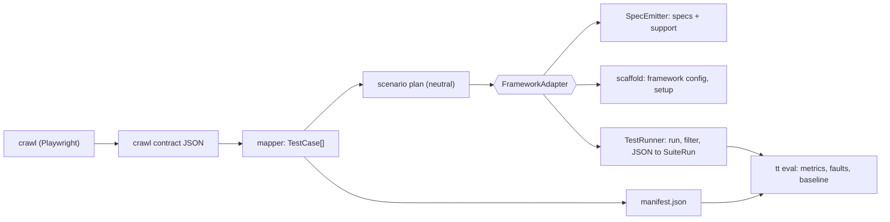

# PRD 1: Framework adapters architecture

Status: Draft. Depends on: none. Read first.

## Problem

`tt` emits Playwright specs and runs, filters, and evaluates them with Playwright. The pipeline up
to the `TestCase` intents is framework-neutral, but everything after it (spec text, support module,
runner, project naming, report parsing) is hard-coded. Adding Cypress today would mean forking the
emitter and the evaluation runner.

## Goals

1. Select the test framework with one config key and keep one code path for everything shared.
2. Make each framework an **adapter** with a small, documented interface.
3. Keep behavior of the existing Playwright output byte-for-byte identical during the refactor.
4. Reach full parity for Cypress (see PRD 4 and PRD 6).

## Non-goals

- Replacing the Playwright crawler (`generator/src/crawl/rendered.ts`). The crawl contract
  (`generator/src/crawl/crawl.ts`, `schemaVersion` 2) is plain data and stays as is.
- New test categories, new oracles, or changes to coverage tiers.
- Supporting a framework in the crawler, or running two frameworks in one `tt eval` run.

## Current state: coupling map

Shared and framework-neutral (must not change meaning):

| Module | Role |
|--------|------|
| `generator/src/crawl/crawl.ts`, `crawl/rendered.ts` | crawl contract and crawler (Playwright by design) |
| `generator/src/generate/mapper.ts` | `TestCase` union: `auth`, `form`, `interaction`, `pagination`, `rbac` |
| `generator/src/generate/fieldgen.ts`, `faker.ts` | field variants; runtime faker expression strings |
| `generator/src/generate/rbac.ts`, `crud.ts`, `manifest.ts` | access matrix, CRUD classification, manifest entries |
| `generator/src/eval/metrics.ts`, `stats.ts`, `eval/faults.ts`, `eval/report.ts` | metrics, statistics, fault catalogue, report |
| `generator/src/emit/index.ts`, `emit/js.ts` | file orchestration, TS to JS transpile |

Coupled to Playwright (adapter territory):

| Area | Where | What is hard-coded |
|------|-------|--------------------|
| Spec text | `emit/ts.ts` (`specSource`, `formTest`, `authTest`, `interactionTest`, `paginationTest`, `rbacTest`, `fillFormSource`) | `test`, `test.describe`, `test.step`, `test.skip`, tag and annotation details, `storageState`, `page.goto` returning a `Response`, locator strictness |
| Support module | `emit/support.ts` (`supportModuleSource`) | fixtures `role` and `app`, login helpers, oracle helpers, `uploadFixture`, `inferLoginControls` |
| Locators | `locator.ts` | priority chain rendered as `getByTestId`, `getByRole`, `getByLabel`, `getByPlaceholder`, `locator` |
| Oracles | `oracle.ts` | assertion strings (`toBeVisible`, `toHaveJSProperty('validity.valid', false)`, `toHaveURL`) |
| Execution | `cli.ts` (`runPlaywright`, `mutationFilterArgs`, `tt report`) | binary, `--grep-invert @write`, `show-report` |
| Evaluation | `eval/playwright.ts`, `eval/runner.ts` | JSON reporter parsing, `--project`, `--grep` regex of titles, per-repeat process, baseline `playwright.config.ts` |
| Scaffold | `playwright.config.ts`, `playwright.global-setup.ts` | projects `<role>-<browser>`, `storageState`, Xvfb for WebKit |
| Baseline analysis | `eval/baseline-static.ts` | regexes counting Playwright APIs |
| Config | `config.ts` | no `framework` key; `evaluation.faultProject` names a Playwright project |

## Target architecture



The adapter is the only place that knows framework syntax and framework CLI.

## Requirements

- R1.1 The system MUST expose a `FrameworkAdapter` registry keyed by `output.framework` (`playwright` default, `cypress`).
- R1.2 A `FrameworkAdapter` MUST provide `emitter`, `scaffold`, and `runner` (interfaces in PRD 2 and PRD 3) plus metadata: `id`, `specGlob`, `supportsBrowsers`, `tagSyntax`.
- R1.3 Code outside `generator/src/adapters/<id>/` MUST NOT import framework-specific packages for spec generation or execution. The crawler is exempt.
- R1.4 With `framework: playwright`, `tt generate` output MUST be identical to the pre-refactor output for the same crawl (checked by a diff of `tests/generated/`).
- R1.5 The manifest MUST be produced by shared code and MUST NOT depend on the adapter, except through the declared `specGlob`.
- R1.6 All existing invariants MUST hold for every adapter:
  1. one test per `TestCase`, exact `testCase.title` as the leaf title, globally unique;
  2. assertion count equals `manifest.ts` (`formAssertionCount`, `hasLandingAssertion`);
  3. tags `@<tier> @<category> @role:<r> @read|@write` are filterable;
  4. faker runs only at test runtime and is seedable via `data.faker.seed`;
  5. no assertion on error message text;
  6. no application endpoint except `hooks.reset`;
  7. locator priority chain, never positional selectors;
  8. emitted code parses and typechecks;
  9. the runner returns `SuiteRun` (`title`, `project`, `status`, `durationMs`).
- R1.7 Adding a third adapter SHOULD require only a new directory under `generator/src/adapters/` and one registry line.

## Proposed layout

```
generator/src/
  scenario/            # neutral scenario plan (PRD 2)
  adapters/
    types.ts           # FrameworkAdapter, SpecEmitter, TestRunner
    registry.ts        # getAdapter(config.output.framework)
    playwright/        # emitter.ts, support.ts, scaffold.ts, runner.ts, json.ts, baseline.ts
    cypress/           # same files
  emit/index.ts        # delegates to the selected adapter, writes manifest
```

## Risks

- The Cypress command-queue model cannot reuse Playwright's `async/await` bodies; the shared layer must therefore describe steps as data, not as code (PRD 2).
- A refactor that changes Playwright output silently would invalidate the published evaluation; guard with R1.4 and the golden tests of PRD 6.

## Acceptance checklist

- [ ] Registry and interfaces exist and the Playwright adapter is the default.
- [ ] `tt generate` output for both case studies is unchanged (empty diff).
- [ ] No Playwright import remains outside `adapters/playwright/` and the crawler.
- [ ] `AGENTS.md` module table lists the adapter layer.
